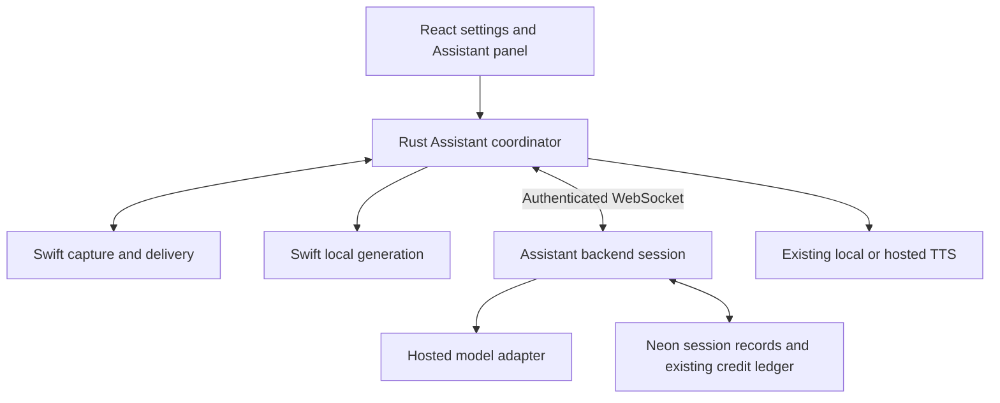

# TextHalo hosted Assistant design

Date: 2026-10-03. Code inspected at commit `9001467`.
Status: original design, now implemented with the approved amendment below. See `hosted-assistant-implementation.md` for delivered behavior, validation and activation. Not deployed.

## Approved implementation amendment (2026-10-03)

The user approved implementation on separate feature branches with this correction: **no typing or typed-input fallback**. Keep the existing hold-to-talk flow and local delivery behavior; route fulfillment to an OpenAI-compatible hosted endpoint. This amendment overrides typed-input references below. Do not add a composer or require typing to use the feature. Retain local speech recognition and report its existing failures honestly. Cloud context uses the same captured selection/window where supported, with cloud-processing consent covering that context; no raw image uploads in v1. The implementation plan below fixes the shared wire contract and identifies the implementation scope; future tools, hosted transcription and vision remain extensions.

## 1. Outcome and scope

Make Assistant usable on Macs where Apple Intelligence is unavailable, with hosted language-model usage deducted from the user's existing TextHalo credit balance. Keep the same hold-to-talk, typed request, selected-text editing, answer, speech, copy, and undo experience.

The hosted service supplies model inference. Native capture, target validation, insertion, clipboard restoration, playback, and any future Shortcuts execution remain on the Mac. Cloud Assistant is a separate TextHalo service, not remote access to Apple's on-device model.

Initial scope: typed requests; voice requests where local speech recognition works; selected text; bounded previous output; optional local OCR of an explicitly attached window or region. Existing on-device behavior remains available. Cloud screen attachment defaults off. No raw image upload, hosted transcription, general shell execution, web search, persistent cloud conversation memory, or Windows support in the first release.

Cloud transcription, vision, and named Shortcuts tools are extensions described below, not prerequisites for a text Assistant. Typed requests must work without microphone or speech-recognition permission.

## 2. Findings from the code

Paths in this document are repository-relative implementation references.

| Area | Current implementation | Design consequence |
|---|---|---|
| Provider gating | `src-tauri/native/Assistant.swift`, `start` and `generate`, reject missing macOS 26/Foundation Models availability | Move checks into the local provider branch; changing only the UI is insufficient |
| Context reasoning | `native/AssistantGeneration.swift` uses `LanguageModelSession` for reference selection and generation | Cloud requests must bypass every local-model stage, including context routing/extraction |
| Response contract | `AssistantGeneration.swift` decodes `0|`, `1|`, `2|`, `3|` into text, speak, read-selection, clarify | Preserve action semantics and normalize both providers into one delivery contract |
| Native transport | `src-tauri/src/assistant.rs` owns a stdin/stdout Swift helper, native events, job identity, and speech dispatch | Rust is the provider coordinator and credential boundary; Swift retains native targets |
| Cancellation | `assistant_job.rs` uses process-local serial IDs; `finish` clears held state but does not invalidate the serial | Add explicit generation terminal state; identity alone does not reject post-completion deltas |
| Dictation | `native/SpeechSupport.swift` requires `supportsOnDeviceRecognition`; `Assistant.swift` forces on-device recognition | An LLM fallback does not fix unavailable speech recognition; offer typing |
| Build floor | `src-tauri/build.rs` targets macOS 14 for arm64 or x86_64, using a recent FoundationModels SDK | This is a build target, not proof of runtime support; test loading and linking on older Macs |
| Screen support | `Contracts.swift` gates screen text at OS major 26; `ScreenCapture.swift` has a macOS 14 capture API; `ScreenText.swift` contains OCR and passage validation | Split capture/OCR capability from local-model capability; qualify older-OS screen support separately |
| UI | `src/serviceReadiness.ts` and `AssistantSettings.tsx` couple Assistant readiness to Apple Intelligence and voice permissions | Readiness must be provider- and input-specific |
| Credentials | `src-tauri/src/hosted.rs` stores desktop credentials securely and serializes refresh; backend authenticates JWT or desktop session | Reuse this account; don't put tokens in React, Swift, prompts, or URLs |
| Billing | `billing/credits.ts`, `db/neon-credit-repository.ts` implement reserves, settlement, grants, expiry, refunds and reversals | Use one existing wallet, with Assistant-specific usage metadata |
| Token accounting | `streaming/pricing.ts` prices input/output/cached tokens in integer nanodollars | Reuse arithmetic, with separately configured Assistant rates |
| Production enhancer | `streaming/semantic-config.ts` wires Jev; retained OpenAI-compatible enhancer classes are not the active general Assistant | Add a dedicated Assistant provider; do not repurpose Jev or assume an LLM is already deployed |
| Runtime | Fastify in `src/app.ts`; `workers/index.ts` separately handles `/v1/tts/stream` with a WebSocketPair | Register Assistant streams in both Node and Worker paths |
| Recovery | `recoverStaleStreams` only recovers `stream:%` reserves after 35 minutes | New Assistant holds need explicit recovery; a new request prefix alone would strand credits |
| History | Swift generation history records prompts, raw output and screenshots, keeps 50 records, hardcodes the local model; Rust supplies its directory | Add truthful provider/billing metadata and disclosure; local history is not ephemeral |

This inspection is static. It does not establish current production configuration, provider contracts, pricing, or compatibility on hardware not tested here.

## 3. Architecture decision

Choose a provider-neutral desktop coordinator plus a metered backend inference service.

Alternatives considered:

1. Put HTTP inference inside Swift: fewer initial bridge messages, but duplicates Rust authentication, networking, cancellation and billing integration. Reject.
2. Replace local Assistant with cloud-only: simpler routing, but removes existing offline behavior. Reject.
3. Coordinate in Rust, execute native operations in Swift, bill inference on the backend: recommended. Reuses the actual application boundaries.



Use WebSocket transport for v1, following the existing deployment's tested transport shape. This replaces the earlier illustrative streaming POST proposal: HTTP is used for capabilities, estimates, status and cancellation; `/v1/assistant/stream` owns live generation. Do not reuse the speech wire protocol or audio chunk orchestration.

No new orchestration framework, vector database or Durable Object is required for this bounded request/response feature. Cross-instance ownership lives in Neon; process-local sets are only optimizations.

## 4. User settings and provider selection

Extend `AssistantSettings` with serde defaults:

```text
provider: local | cloud | automatic        default: local
cloud_consent_version: optional integer    default: absent
cloud_screen_context: off | explicit_ocr   default: off
```

Existing language, instruction and dictation-output settings remain. Existing installations stay local until the user enables Cloud or Automatic. Cloud consent describes sending requests, preferences, prior answer when used, and attached context to TextHalo and its inference provider. Screen attachment is a separate visible choice. Changing consent versions cannot silently authorize expanded data sharing.

| Selection | Routing |
|---|---|
| Local | Require local-model availability; never switch to paid inference |
| Cloud | Require enabled cloud processing, account, service availability and credits |
| Automatic | Choose local when available at request start; otherwise cloud if enabled and ready |

Freeze the chosen provider for the request. Do not automatically repeat an in-progress local failure on cloud, or repeat a partially streamed cloud answer elsewhere. Offer an explicit retry choice. This prevents duplicate output, unexpected charges and attempts to route around provider refusals.

The panel shows “On this Mac” or “TextHalo Cloud”, processing state, attachments and usage. It shows “Checking usage…” after output completion if settlement is pending. Credit errors offer account/top-up navigation while retaining the request draft. An unpaid account with valid top-up credits can use Cloud; no extra subscription gate is proposed.

## 5. Capabilities and compatibility

Represent capabilities independently: local generation, hosted generation, local transcription for the selected locale, accessibility insertion, screen capture, OCR, cloud vision, and speech output. Include machine-readable reason codes rather than matching strings such as `appleIntelligenceNotEnabled` in the frontend.

The effective readiness calculation combines cached native capabilities with authenticated backend capabilities. Do not make an HTTP call every time the current three-second native availability poll runs. Refresh cloud capability/balance on sign-in, settings open, request terminal events and a short cache expiry.

Readiness rules:

- Typed cloud request: cloud enabled, signed in, backend available; no microphone requirement. Without Accessibility, display/copy remains usable, insertion and selection capture are disabled.
- Voice cloud request: typed-cloud requirements plus local recognition and microphone permissions/assets. If unavailable, typing remains usable.
- Local generation: runtime availability check, not a chip-name guess.
- Screen attachment: capture/OCR capability and Screen Recording permission. It must not block unrelated writing.
- Speech output: selected voice engine readiness independently of inference.

Intended qualification floor: macOS 14, matching the helper target. Test Intel/macOS 14–15, Apple Silicon without Apple Intelligence, and supported Macs with it enabled and disabled. Verify app and helper startup, weak linking/framework availability, permissions, capture and output. If importing FoundationModels prevents helper loading, split local generation into a separately launched macOS-26+ helper and keep capture/delivery in the base helper. Do not ship an unsupported hardware claim based on the deployment target alone.

Apple documents runtime model availability checks in its [Foundation Models guide](https://developer.apple.com/documentation/FoundationModels/generating-content-and-performing-tasks-with-foundation-models).

## 6. Native bridge and request lifecycle

Use three distinct identifiers:

- Existing local serial: invalidates stale native/UI events.
- `interactionId`: UUID joining generation and optional speech usage.
- `requestId`: UUID/idempotency key for one hosted generation attempt, persisted locally before sending.

A retry that only checks status retains its request ID. An explicit request to generate again receives a new ID. Never derive backend identity from the process-local serial alone.

Add a versioned native handshake. Rust fails clearly if the bundled helper cannot speak the expected protocol. Extend `Request`/event types rather than continuing to proliferate untyped commands.

Proposed internal messages:

```text
Rust -> Swift: prepare_request(id, provider, input, contextPolicy)
Swift -> Rust: generation_input(id, request, preferences, selection,
                              sourceMetadata, previousOutput, optionalOcr)
Rust -> Swift: generate_local(id, input)
Rust -> Swift: generation_snapshot(id, sequence, action, fullText)
Rust -> Swift: generation_complete(id, action, fullText)
Rust -> Swift: generation_error(id, code, partialText)
Rust -> Swift: cancel(id)
```

Names are proposed. Native target objects and images remain in Swift. `prepare_request` captures/retains the original source before overlay focus changes. Local generation can use its existing context preparation; cloud preparation cannot invoke `LanguageModelSession` at any stage.

Rust converts append-only network deltas to bounded cumulative snapshots because existing playback and insertion paths consume snapshots. Validate monotonic sequence numbers, fixed action, maximum output, active serial, and nonterminal generation state. Swift performs the same identity/terminal checks before a native mutation. Never await a network operation while holding `AssistantState.inner`'s mutex; snapshot state, release the lock, spawn cancellable work, then re-check identity on delivery.

State progression:

```text
idle -> capturing/typing -> preparing -> reserving -> generating
     -> delivering -> completed
any active state -> canceling -> canceled
any active state -> failed
billing state: none -> reserved -> settling -> settled/released/recovery_pending
```

Keep output lifecycle and billing lifecycle separate. A delayed usage event updates accounting only; it cannot insert text or speak again. Cancellation, replacement, sign-out, app shutdown, helper death and playback-stop propagation all cancel the hosted task and native delivery. Backend settlement must continue independently of UI lifetime.

## 7. Context and model contract

Keep v1 stateless on the server for content. Send the current request, user preferences, selected text and at most the previous answer used for follow-up editing. Do not automatically upload all local history.

Proposed ceilings, based on existing bounds:

| Field | Limit |
|---|---:|
| Request | 4,000 Unicode scalar values |
| Preferences | 2,000 |
| Previous output | 6,000 |
| Combined selection, source metadata and OCR context | 10,000 |
| OCR within that context | 6,000 |
| Serialized start message | 128 KiB |
| Generated text | 32 KiB UTF-8 and 2,048 provider output tokens, whichever comes first |
| Generation wall time | 90 seconds after dispatch |
| Entire accepted request | 120 seconds |

These are proposed product limits, not provider limits. Standardize Unicode scalar counting across Rust, Swift and TypeScript; currently Swift `String.count` and Rust `chars().count()` differ. Validate final serialized token budget server-side, including system instructions and message framing. Reject over-limit input with a clear error rather than invisibly truncating a requested passage. For optional metadata/previous answer truncation, mark exactly what was omitted.

Cloud context policy: no automatic screenshot upload. Selected text is sent only under enabled cloud processing and shown as attached. Explicit screen attachment runs local OCR and sends bounded text. Treat selection, OCR and app metadata as untrusted quoted data. Use one hosted generation call to choose an action and answer; v1 does not require a separate classifier call. If the input lacks context needed to answer, return clarify. Requests that require visual understanding beyond OCR should report that limitation.

Provider adapter returns normalized events: action, text delta, usage, finish or error. Initially reuse the four-marker semantic contract behind a strict incremental decoder, keeping markers off the public stream. Buffer the marker until valid; reject a malformed prefix or action switch. Never apply a regex to execute commands in answer text. `read-selection` resolves to the frozen selection on the client; reject it when no selection exists. Raw OCR is not an exact selected passage: only use the existing passage-validation logic for claims of verbatim extraction; otherwise label a summary or ask for selection.

System instructions are owned and versioned by the backend. User instructions cannot replace them. Share contract fixtures between Swift, Rust and backend tests. Model failures return safe codes rather than raw provider errors or prompts.

## 8. Model adapter and configuration

Implement a new `AssistantProvider` abstraction with bounded input estimation, streaming, abort, normalized usage, and explicit supported capabilities. Begin with an OpenAI-compatible HTTP adapter to match existing transport experience; compatibility is validated against the chosen endpoint, not inferred from its label. The active Jev semantic-cue selector remains unchanged.

Expose one stable product model alias, `assistant-standard`, with an immutable rate version for each request. Do not expose arbitrary provider URLs/model names to clients. Proposed configuration:

```text
ASSISTANT_ENABLED
ASSISTANT_PROVIDER / ASSISTANT_BASE_URL / ASSISTANT_API_KEY
ASSISTANT_MODEL / ASSISTANT_MODEL_REVISION
ASSISTANT_INPUT_NANODOLLARS_PER_TOKEN
ASSISTANT_CACHED_INPUT_NANODOLLARS_PER_TOKEN
ASSISTANT_OUTPUT_NANODOLLARS_PER_TOKEN
ASSISTANT_CREDITS_PER_DOLLAR / ASSISTANT_RATE_VERSION
ASSISTANT_MAX_OUTPUT_TOKENS / ASSISTANT_MAX_REQUEST_CREDITS
```

Choose the production model after a small evaluation of edits, action selection, grounded context answers, multilingual requests, latency and billable usage reporting. No inspected code establishes a suitable production Assistant model or current price. Accordingly this design does not invent either: exact provider SKU, current verified rates and data-retention terms are release configuration decisions. Require bounded billable output including any hidden reasoning tokens, reliable usage normalization, cancellation and the needed contract accuracy before activation. Avoid opaque-cost models in v1.

Invalid or incomplete Assistant configuration disables Assistant cloud capability without taking TTS down. Existing `createRuntime` still requires Fish credentials for the combined backend; don't claim this change creates a standalone inference deployment.

## 9. Backend API and streaming

All Assistant routes authenticate with the existing account mechanisms, except optional non-sensitive public feature metadata. Never accept user ID, token cost or balance from the client.

| Endpoint | Purpose |
|---|---|
| `GET /v1/assistant/capabilities` | Model alias, enabled state, limits, rate version and supported context/input |
| `POST /v1/assistant/estimate` | Server-computed reservation for the exact bounded input; no hold or inference |
| `GET /v1/assistant/stream` | WebSocket upgrade; authenticated start launches one request |
| `GET /v1/assistant/requests/:requestId` | Owned request status and authoritative usage; no output replay |
| `POST /v1/assistant/requests/:requestId/cancel` | Idempotent cancellation across runtime instances |

Start payload: protocolVersion, bearer token, requestId, interactionId, modelAlias, rateVersion, maxCredits, request/preferences/context/previousOutput. Place token in the first message, never in URL parameters or logs. Require authentication within five seconds and accept one start per connection. Client `maxCredits` is a ceiling only. Server recalculates the reservation and requires the supplied rate version still be usable before dispatch.

Server events, each with requestId and monotonic sequence:

```text
accepted { provider, modelAlias, rateVersion, reservedCredits }
action { action: text | speak | read-selection | clarify }
text_delta { text }
generation_done { finishReason }
usage { state, inputTokens, cachedInputTokens, outputTokens,
        chargedCredits, refundedCredits, availableCredits }
done { requestStatus, billingStatus }
error { code, retryable, billingStatus }
```

Heartbeat/ping frames carry no prompt content. Stop messages abort the active provider call. Bound buffers and close a persistently slow consumer instead of continuing paid generation into unbounded memory. The first implementation needs no automatic stream reconnection/replay; after connection loss, query status using the same request ID and offer an explicit new request if the user wants regeneration.

Errors include unauthorized, cloud_disabled, invalid_request, context_too_large, insufficient_credits, rate_changed, request_conflict, request_in_progress, rate_limited, provider_unavailable, invalid_model_output, timeout, canceled and billing_pending. Normal HTTP endpoints use appropriate 4xx/5xx responses; errors after upgrade are protocol events.

Register handlers by route path in `createRuntime` and `workers/index.ts`, replacing the single captured stream handler with a map/registry. Preserve `/v1/tts/stream`. Avoid double-registering Fastify's WebSocket plugin when both features are active. Share session logic between Node and Worker adapters. Track active tasks and await their bounded settlement before closing request-owned DB pools.

Cloudflare documents that `waitUntil()` only extends HTTP work for a bounded period after response/disconnect; it is not durable settlement. Use durable DB state and recovery, not a promise alone: [Cloudflare context documentation](https://developers.cloudflare.com/workers/runtime-apis/context/).

## 10. Credit economics and charging policy

Use the same plan and top-up grants, expiry order and reversal/debt rules. Do not create an Assistant wallet or a new Stripe product. Update plan and purchase copy so credits clearly cover hosted AI and speech.

With integer nanodollar rates:

```text
cost = (inputTokens - cachedInputTokens) * inputRate
     + cachedInputTokens * cachedInputRate
     + billableOutputTokens * outputRate
credits = ceil(cost * assistantCreditsPerDollar / 1,000,000,000)
```

Reuse `enhancementNanoDollars`/`cumulativeCredits`, preferably renamed or wrapped as generic token-pricing helpers. Normalize provider reasoning/cache semantics first; don't double-count reasoning tokens already included in output. Freeze rates and model revision at reservation.

Reserve a conservative model-specific upper bound for the serialized input plus enforced output cap, with no cache discount assumed. Use a verified tokenizer/accounting method; do not claim arbitrary character counts are safe token bounds for all providers. Enforce a per-request credit ceiling. Exact balance/reservation checks happen atomically in the database. Client estimates are informational and do not authorize overspending.

Illustrative arithmetic only: if a request's accounted provider cost were $0.001 and the configured multiplier were 20,000 credits per provider dollar, it would cost 20 credits. This is not a quoted model price or a proposed reuse of the enhancer tariff.

Proposed settlement policy:

| Outcome | Customer charge |
|---|---|
| Valid complete response | Confirmed billable token usage |
| User cancels/disconnects after inference starts | Confirmed usage already incurred; unused hold returned |
| Failure before provider dispatch | Zero; full release |
| Service timeout, malformed output or provider fault | Zero; TextHalo absorbs attempt cost in v1 |
| Provider usage unavailable at recovery deadline | Zero for unknown usage; release the hold and record absorption |
| Settlement temporarily unavailable | Keep durable pending state; no duplicate call; reconcile later |

Distinguish customer cancellation from service faults. Do not use the speech path's estimated-usage fallback as the default for Assistant. Charge once per request rather than rounding each delta. No automatic paid model retries in v1; a retry can run only when transport proves the original was not accepted, or as an explicit new user request.

Actual usage must never charge above the accepted reservation. If provider accounting exceeds the bound, absorb excess, record the discrepancy and disable/repair that model's estimator. The existing generic repository can attempt additional balance debits; the Assistant settlement layer must explicitly cap customer charges before calling it.

Generation and hosted TTS have separate reservations and records, joined by interactionId. If inference succeeds but credits cannot cover Fish speech, retain/display the answer and report that speech could not start. Never discard the answer or imply spoken delivery succeeded. Local speech incurs no hosted speech charge. A later “Speak” action creates its own speech usage, not another inference charge.

## 11. Durable ownership, idempotency and recovery

Add migration `011_assistant_requests.sql` (verify the next migration number at implementation time). Proposed table `assistant_requests`:

```text
user_id, request_id                  composite primary key
interaction_id
request_fingerprint                 HMAC of canonical request/config; no raw prompt
status                              accepted/running/completed/canceled/failed/interrupted
billing_status                      reserved/settling/settled/released
model_alias, provider_model, rate_version, rate_snapshot
reservation_id, reserved_credits
owner_token, lease_expires_at, hard_deadline_at
cancel_requested_at
provider_request_id
usage_details                       normalized confirmed usage; no text
charged_credits, refunded_credits
failure_code, created_at, updated_at
```

Store the HMAC key version to support key rotation without silently changing duplicate semantics. Use the RLS patterns already present in migration 006, user-scoped queries and matching tests. Don't store prompts, selection, screenshots, output or credentials in billing tables. Session metadata retention: proposed 90 days for operational lookup; financial records follow the existing billing retention policy. Keep compact request-key/fingerprint tombstones with retained ledger rows so cleanup cannot make an old request chargeable again.

Admission must atomically claim the request, enforce one live Assistant generation per user and reserve funds. Extend the Neon transaction layer so all three use the same connection and transaction; separate public calls to `reserve` and `insert request` are not atomic. Lock the credit account row first, consistently across operations, to serialize cross-device admission and avoid lock-order deadlocks. TTS may run concurrently, subject to the same wallet's atomic reservations.

Duplicate rules: same user/key and same fingerprint returns existing status without dispatch; same key/different fingerprint returns conflict; another user cannot read or cancel the request. If a completed output is not on this client, status returns usage only and the UI explains that regeneration is a new request. Exactly-once provider execution across crashes cannot be guaranteed by a local flag: mark dispatch ownership durably before the call, never re-dispatch an ambiguous attempt, and absorb unknown crash-time costs.

Lease proposal: heartbeat every five seconds, lease valid for 30 seconds, absolute hard deadline 120 seconds. Heartbeats also check cancellation. Every write uses an owner-token comparison and terminal-state predicate. A worker losing its lease aborts, stops delivering and cannot settle or revive the request. Recovery atomically revokes the owner before release. Persist provider usage immediately when received; final session status and ledger settlement happen in one transaction.

Recovery runs on account/balance/admission access and through a scheduled bounded sweep for abandoned users. Add a Worker scheduled handler/trigger and Node equivalent if used; runtime configuration currently has neither for Assistant. Sweep only expired leases or hard deadlines. Settle persisted confirmed usage according to the outcome policy; release unknown holds. Treat old worker completions as stale. Keep existing `stream:%` recovery behavior intact rather than broadening its pattern and deadline without distinguishing request types.

Rate limiting: enforce one active request plus a proposed 10 starts/minute/user in durable admission state; apply an edge IP limit to unauthenticated upgrade abuse. Final thresholds are operational defaults, adjustable without changing the protocol. Budget alarms and a global cloud-disable flag bound losses from absorbed failures.

## 12. Delivery, history and privacy

Extract provider-independent Swift reply handling from `generate`: streaming text insertion, final insertion, speech dispatch, clarification and copy/undo share one implementation. Preserve `Target`'s original-field snapshots, receipts and compare-before-write checks. If target validation fails, show/copy the response; do not paste into whichever app is now focused.

Keep existing streaming insertion behavior only while target validation succeeds. A cancellation may leave already inserted partial text; retain its valid undo receipt and explain the partial result. Never automatically roll back after unrelated user edits. Once mutation fails, freeze insertion for that request and continue output in the panel.

The current history writer finalizes at result/error, but billing may arrive later. Add a narrowly scoped metadata-update path keyed by request ID, or a local usage sidecar joined by ID, that cannot rewrite generated text or reopen delivery. Record chosen provider, actual model, rate version, request/interaction IDs, generation status and billing status. Replace the hardcoded Apple model label. Update Rust history summaries and React detail views.

Keep the current 50-record content retention unless the user changes the policy. Add visible history disclosure and deletion support; raw screenshots should not be newly persisted for Cloud OCR by default. No server-side prompt logging or model-output logging. Disable request-body/token logging and sanitize provider error payloads. Provider retention/training terms must be verified for the selected service before describing cloud processing as private or transient.

## 13. Future Shortcuts, transcription and vision

Shortcuts are a separate tool capability. Discover saved shortcuts locally with `shortcuts list --show-identifiers`, allow the user to enable specific IDs, and send only the necessary enabled tool descriptions. Backend proposes a typed invocation; Rust validates the current request, allowed ID and argument schema, then invokes the binary with an argument array, not shell interpolation. Require explicit confirmation for consequential actions such as sending or deleting. An enabled shortcut can change after discovery, so arbitrary shortcut names are not a trusted description of effects.

Use invocation IDs and a local execution receipt; never blindly replay a tool after reconnect. Return bounded tool results as untrusted data. Reserve another model-turn budget before a follow-up inference call, enforce tool/turn limits, and require all local side-effect approval on the Mac. Listing or running a local shortcut has no separate TextHalo charge; model turns are charged. V1 exposes no tools, so there is no accidental remote shell interface.

Hosted transcription is a separate upload/stream service with microphone consent, audio-duration/byte limits, per-duration pricing and the same wallet. It should be added if the intended audience needs voice on machines/locales without local recognition. Cloud vision similarly needs an explicit image consent, dimensions/size limits and a provider-specific image token estimator. Neither may silently bypass the v1 context rules.

## 14. File-level implementation map

| Files | Work |
|---|---|
| `src-tauri/src/config.rs` | Provider/consent/context defaults and migration behavior |
| `src-tauri/src/assistant.rs`, `assistant_job.rs` | Coordinator, active-task cancellation, typed generation lifecycle, stale-event rejection |
| New `src-tauri/src/hosted_assistant.rs` | Authenticated stream client, bounded event decoding, status recovery |
| `src-tauri/src/hosted.rs` | Small crate-private authenticated client/token interface; reuse refresh without exposing secrets |
| `src-tauri/src/lib.rs` | Register new module and any capability commands |
| `src-tauri/native/Contracts.swift`, `Assistant.swift` | Versioned bridge, cloud preparation, provider-independent delivery |
| `AssistantGeneration.swift` | Local-only provider checks, shared action contract |
| `ScreenText.swift`, `ScreenCapture.swift`, `build.rs` | Independent capability gates; older-macOS linking and OCR qualification |
| `GenerationHistory.swift`, `src-tauri/src/generation_history.rs` | Accurate provider/usage metadata, late billing updates and deletion |
| `src/AssistantSettings.tsx`, `serviceReadiness.ts`, `App.tsx` | Provider picker, consent, capability-specific readiness, account refresh |
| `src/AssistantPanel.tsx`, `GenerationHistory.tsx` | Provider label, usage/pending states, partial output and history details |
| New `texthalo-server/src/assistant/{types,provider,prompt,session,routes}.ts` | Request schema, model adapter, normalized streaming and policy |
| New backend Assistant repository and migration | Atomic admission, ownership, idempotency, recovery and RLS |
| `billing/credits.ts`, `db/neon-credit-repository.ts`, `streaming/pricing.ts` | Transaction reuse, cap-aware settlement, generic pricing arithmetic |
| `app.ts`, `runtime.ts`, `config.ts` | Feature registration, configuration and truthful plan/capability metadata |
| `workers/index.ts`, `workers/socket.ts`, deploy/config scripts | Multiple stream routes, task cleanup, recovery trigger and secret configuration |
| Website pricing/privacy/feature copy located during implementation | Shared-credit explanation and verified platform support |

## 15. Verification and rollout

Tests should prove contracts and failure behavior, not merely mirror helper functions.

1. Backend unit tests: Unicode limits, split markers, invalid actions, bounded output, cached/reasoning usage normalization, rounding, reservation ceilings, unknown usage and cancellation policy.
2. Database integration: concurrent devices, concurrent TTS/Assistant spending, duplicate IDs, changed fingerprints, RLS isolation, expiry/reversal refunds, atomic rollback, lease loss and crash recovery. Use existing database test patterns; a memory repository alone is inadequate for locks.
3. Native/Rust tests: absent Foundation Models, typed-only operation, cloud preparation without local model calls, stale deltas after complete/cancel/new request, changed insertion target, helper death, partial undo and sign-out cancellation.
4. End-to-end mock provider: split network frames, disconnect before/after acceptance, dropped usage event, backend restart, slow client, settlement DB failure, canceled request status recovery, insufficient credits for TTS after successful generation.
5. Both backend runtimes: Fastify and Worker stream routing/auth/cleanup; existing TTS regression suite. Check Worker behavior in its actual runtime, not only Node mocks.
6. Hardware matrix described in section 5, including helper launch on Intel and macOS 14/15. Screen support and local transcription qualify independently.
7. Model evaluation: representative writing/editing/clarification/read-selection cases, multilingual and adversarial quoted context. Track action validity, unsupported claims, first-response latency and actual cost; activate only after agreed acceptance thresholds.

Use existing commands as applicable: root `npm test`, `npm run typecheck`, backend `npm test`, `npm run build`, `npm run worker:typecheck`, `npm run worker:test`, Rust tests and native Swift test compilation used by project scripts. Add tests for new boundaries before claiming compatibility. No implementation tests have been run for this design-only change.

Rollout sequence:

1. Land additive schema/protocol fixtures and feature-off backend. Old desktop clients continue unchanged.
2. Refactor local delivery with parity tests; add Cloud client behind a flag.
3. Enable staff accounts with a mock/controlled provider and strict spend ceiling.
4. Qualify chosen production model, rates, data handling and hardware matrix; enable a small cohort.
5. Broaden only after billing reconciliation, latency, failure and compatibility metrics pass.

Monitor request counts, first delta/completion latency, cancellations, protocol failures, token usage, reserved/charged/refunded credits, absorbed cost, stale leases and settlement delay. Do not attach user content to metrics. Alarm on stuck holds, over-reservation discrepancies and provider error spikes.

Rollback: disable new cloud admissions, allow already accepted requests to settle, keep recovery running, and retain additive tables/records. Never silently reroute cloud users to another paid model or leave reservations dependent on the disabled inference path.

## 16. Acceptance and remaining release decisions

The feature is ready when an unsupported-Apple-Intelligence Mac can type a request, receive and safely use the answer, and see one accurate debit from its existing wallet; voice works wherever local recognition is available; local Assistant remains functional; canceled/stale work cannot mutate an app; retries cannot double-charge; abandoned holds recover; and both deployment runtimes pass integration tests.

Architecture decisions above are concrete recommendations. Before production activation, choose and verify the exact model/revision, actual rates and margin, provider data terms, supported hardware/OS matrix, and operational evaluation thresholds. These cannot be truthfully inferred from the repository. They do not block implementing the provider abstraction and mock-backed tests, but they do block advertising compatibility or enabling paid inference broadly.
